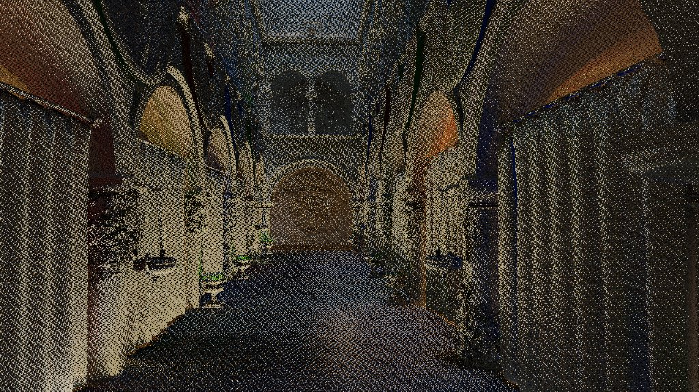

# Showcase

Feature pages for the engine, each with images and measured numbers. Adapted from [Vuk Đorđević's master's thesis (ETF Belgrade, 2026)](https://github.com/MegatronJeremy/RG2/tree/master/master-rad/teza), updated to the engine as it is now.

Every measured number names its GPU, the commit that holds it and the date. Pages describe the current engine; [`AGENTS.md`](../../AGENTS.md) is the authority where they differ.

| Page | What it shows | Status |
| --- | --- | --- |
| [Hybrid RT pipeline](hybrid-rt-pipeline.md) | Raster G-buffer plus inline ray-query effects, cost per effect | written |
| [RT shadows](rt-shadows.md) | Inline per-light shadows against the experimental stochastic pass | written |
| [RT ambient occlusion](rt-ambient-occlusion.md) | Traced AO against SSAO: term, quality against the path tracer, cost | written |
| [Reflections](reflections.md) | SSR and RT reflections, roughness cutoff, why the denoiser is off | written |
| [RT global illumination](rt-global-illumination.md) | Traced and screen-space GI: quality against the path tracer, cost, the ReSTIR experiment | written |
| [SVGF-style denoising](svgf-denoising.md) | The shared temporal plus a-trous chain: what it buys, where it hurts, per-pass cost | written |
| [Path-traced reference and quality benches](path-traced-reference.md) | The converged path tracer as ground truth; FLIP, tFLIP and JOD gates, static and under motion | written |
| [Asset pipeline](asset-pipeline.md) | Content-hash cook cache, mounted virtual paths, role-based BCn texture compression: sizes, GPU time, quality cost | written |
| [Texture block compression](texture-compression.md) | Role-based BC1/BC3/BC5 (BC7 opt-in), why normals are not BC1, cache, VRAM, Forward-pass and FLIP cost | written |
| [Editor](editor.md) | Panels, Play and Play Standalone, content browser, material editor, CVar panel, NERV theme | written |
| [Performance](performance.md) | perf-bench config ladder, paired A/B gate, RGA occupancy, driver shader stats | written |
| [Neural upscaler](neural-upscaler.md) | Spatial and temporal CNN refiners over a low-res render, the LPIPS-against-PSNR selection trap, what was and was not beaten | written (experimental) |
| [Sorted transparency](sorted-transparency.md) | `Blend` materials in a far-first sorted pass behind `render.transparent`, the `AlphaBlend.world` testbed, what it cannot order | written (experimental, no render yet) |
| [Clustered light culling](clustered-lights.md) | Cluster grid, CPU light assignment, the DefaultLit shade path behind `render.lights.cluster.shade`, the overflow rule | written (experimental, not measured on a GPU) |
| [Dynamic-sun IBL re-bake](dynamic-sun-ibl.md) | The `SunNeedsRebake` rule (direction quantum, 5% radiance, appear/disappear), the `SunSweep.world` testbed, what a re-bake costs | written (experimental, not measured on a GPU) |
| [ECS scheduling](ecs-scheduling.md) | `SystemAccess` declarations, `BuildSchedule` staging behind `ecs.schedule`, `ParallelForEach` and `ParallelGather`, the `ecs.parallel` A/B | written (experimental, not measured) |

## Gallery

Sponza on a Radeon RX 9070 XT unless a caption says otherwise. Every image is under 500 KB; the pages above carry the numbers.

| | |
| --- | --- |
|  |  |
| Full hybrid pipeline ([Hybrid RT pipeline](hybrid-rt-pipeline.md)) | The editor |
|  |  |
| Shadow map, mode 1 ([RT shadows](rt-shadows.md)) | Ray traced, mode 2 ([RT shadows](rt-shadows.md)) |
|  |  |
| AO term ([RT ambient occlusion](rt-ambient-occlusion.md)) | Reflection buffer ([Reflections](reflections.md)) |
|  |  |
| GI term ([RT global illumination](rt-global-illumination.md)) | Raw GI buffer before the denoiser ([SVGF-style denoising](svgf-denoising.md)) |

Images shared with the top-level README live in `docs/images`; images specific to one page live in `docs/showcase/images`.
