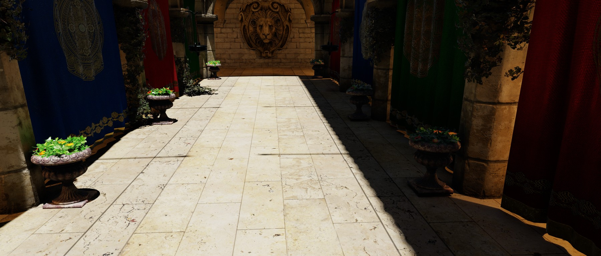
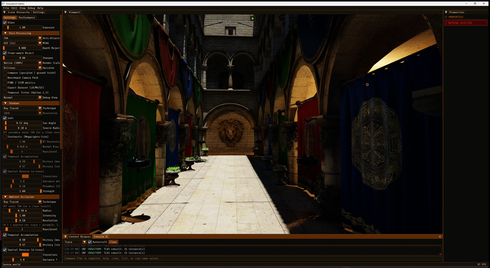
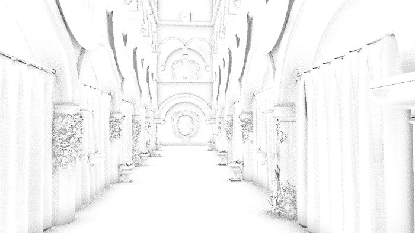
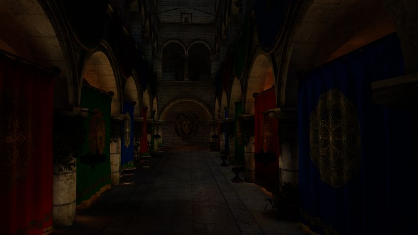

# Showcase

Feature pages for the engine, each with images and measured numbers. Adapted from [Vuk Đorđević's master's thesis (ETF Belgrade, 2026)](https://github.com/MegatronJeremy/RG2/tree/master/master-rad/teza), updated to the engine as it is now.

Every measured number names its GPU, the commit that holds it and the date. Pages describe the current engine; [`AGENTS.md`](../../AGENTS.md) is the authority where they differ.

| Page | What it shows | Status |
| --- | --- | --- |
| [Hybrid RT pipeline](hybrid-rt-pipeline.md) | Raster G-buffer plus inline ray-query effects, cost per effect | written |
| [RT shadows](rt-shadows.md) | Inline per-light shadows against the experimental stochastic pass | written |
| [RT ambient occlusion](rt-ambient-occlusion.md) | Traced AO against SSAO: term, quality against the path tracer, cost | written |
| [Reflections](reflections.md) | SSR and RT reflections, roughness cutoff, why the denoiser is off | written |
| [RT global illumination](rt-global-illumination.md) | Traced and screen-space GI: quality against the path tracer, cost, the ReSTIR experiment | written |

## Gallery

Sponza on a Radeon RX 9070 XT unless a caption says otherwise. Every image is under 500 KB; the pages above carry the numbers.

| | |
| --- | --- |
|  |  |
| Full hybrid pipeline ([Hybrid RT pipeline](hybrid-rt-pipeline.md)) | The editor |
|  |  |
| Shadow map, mode 1 ([RT shadows](rt-shadows.md)) | Ray traced, mode 2 ([RT shadows](rt-shadows.md)) |
|  |  |
| AO term ([RT ambient occlusion](rt-ambient-occlusion.md)) | Reflection buffer ([Reflections](reflections.md)) |
|  | |
| GI term ([RT global illumination](rt-global-illumination.md)) | |

Images shared with the top-level README live in `docs/images`; images specific to one page live in `docs/showcase/images`.
