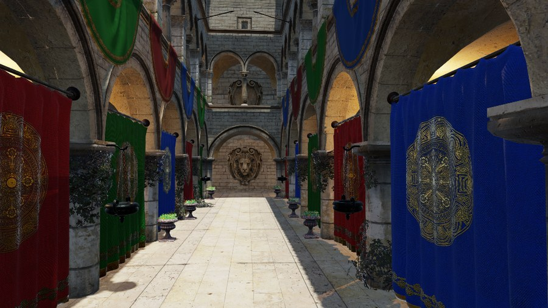
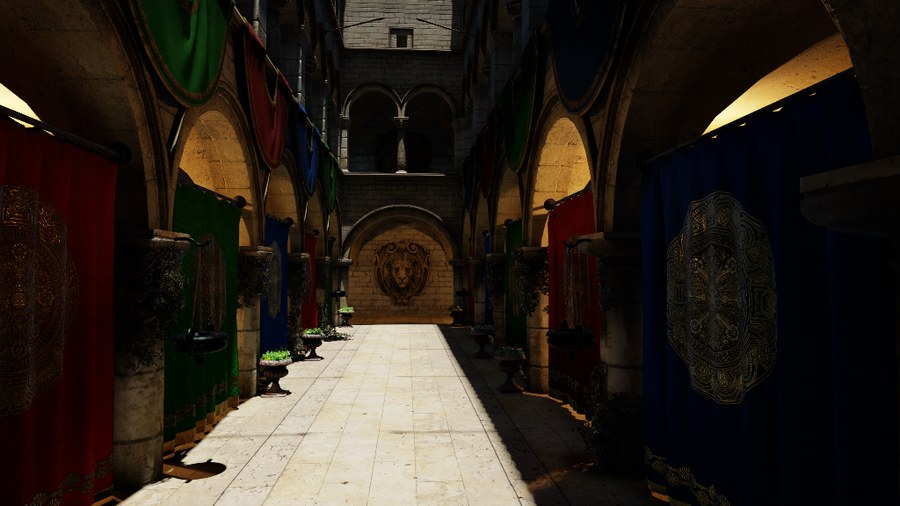

# Hybrid RT pipeline

*Adapted from [Vuk Đorđević's master's thesis (ETF Belgrade, 2026)](https://github.com/MegatronJeremy/RG2/tree/master/master-rad/teza).*

The renderer is a rasterized forward pass with four effects added through inline Vulkan ray queries (`RayQuery` against the scene TLAS, no ray-tracing pipeline or shader binding table): shadows, ambient occlusion, reflections and global illumination. Each ray-traced effect has a screen-space counterpart behind the same mode CVar, so the two can be compared on the same scene.

| Without ray tracing | With all four effects |
| --- | --- |
|  |  |

## Frame structure

1. `DepthNormal` and `Velocity` build the G-buffer (depth, geometric normal, motion vectors).
2. GI and AO run as compute passes before shading, at half resolution by default (`render.gi.scale`, `render.ao.scale` = 0.5): trace, temporal accumulation, a-trous denoise, depth-aware upsample.
3. Reflections run at full resolution: trace, then temporal accumulation. The a-trous filter is off by default (`render.reflections.denoise.iterations` = 0).
4. `Forward` (`DefaultLit`) runs after a depth prepass, so the lit shader executes once per visible pixel. It traces shadow rays inline and combines direct light with the three textures above.
5. `TemporalResolve` (TAA) and tonemap.

Shadows are the exception to "trace, then reconstruct": a visibility test is one bit, cheap to compute exactly and expensive to reconstruct, so for a handful of lights the shader answers it in place with no denoiser. The cost is linear growth in light count; see [RT shadows](rt-shadows.md).

Effects that need only visibility (shadows, AO) stop at the first hit (`RAY_FLAG_ACCEPT_FIRST_HIT_AND_END_SEARCH`). Reflections and GI take the closest hit and shade it through `ShadeSurfaceHit` in `Engine/Shaders/Include/RTHitShading.hlsli`, which resolves the hit triangle through the bindless geometry table. Secondary hits get a Lambertian diffuse term, emissive and image-based ambient, with no specular lobe, so metal-on-metal interreflection is absent. The path tracer (`render.pathtrace`) does include it.

| Effect | Mode CVar | Screen-space alternative | Rays per pixel (default) | Scale |
| --- | --- | --- | --- | --- |
| Shadows | `render.shadows.mode` = 2 | shadow map (mode 1) | 2 per light | 1.0 |
| AO | `render.ao.mode` = 2 | SSAO (1) | 2 | 0.5 |
| Reflections | `render.reflections.mode` = 2 | SSR (1) | 1 | 1.0 |
| GI | `render.gi.mode` = 2 | SSGI (1) | 2 | 0.5 |

All effects default to off or the raster path in code; the benchmark ladder below enables them one at a time. On a device without ray-query support, mode 2 falls back to off.

## Cost per effect

`Scripts/perf-bench.py` enables one effect per rung, so the difference in whole-frame GPU time between adjacent rungs is that effect's cost (the effects are inline in `Forward`, so there is no separate scope to read).

Source: committed baselines in `Scripts/perf-baseline/<adapter>/`, commit `b253f91`, 2026-09-08. Sponza, 1920x1080, 300 frames per run, median of 5 runs, `totalGpuMs`. Deltas are differences of those medians.

| Rung | RX 9070 XT total | step | RTX 5070 total | step |
| --- | --- | --- | --- | --- |
| `rt-off` | 2.375 ms | | 1.319 ms | |
| `shadows` | 4.666 ms | +2.292 | 2.845 ms | +1.526 |
| `+ao` | 5.525 ms | +0.859 | 3.621 ms | +0.775 |
| `+refl` | 7.274 ms | +1.749 | 4.742 ms | +1.121 |
| `+gi` | 8.991 ms | +1.717 | 6.155 ms | +1.413 |

Read these with the run spread in mind: between runs of the same configuration the 9070 XT `rt-off` rung spreads 14.5% (the GPU downclocks when the frame is this light), and the 5070 `shadows` and `+ao` rungs spread about 3.4%. Per-effect steps smaller than a few tenths of a millisecond are not resolved by a golden baseline; use the paired `--compare-exe` A/B described in `AGENTS.md`.

The thesis tables report 8.62 ms and 6.01 ms at `+gi` for the same two cards at 1915x1064 (September 2026). The committed baselines above were re-captured at the pinned 1920x1080 and are the numbers of record.

## Reproduce

```
py Scripts/perf-bench.py                    # run the matrix, diff vs baseline
py Scripts/perf-bench.py --only +gi         # one rung
py Scripts/quality-bench.py                 # FLIP/PSNR/SSIM of each technique against the path tracer
```

Quality is measured against a converged path trace of the same view; see the image-quality section of `AGENTS.md`.
