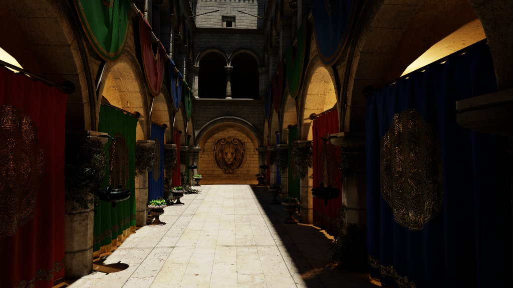

# Path-traced reference and quality benches

*Adapted from [Vuk Đorđević's master's thesis (ETF Belgrade, 2026)](https://github.com/MegatronJeremy/RG2/tree/master/master-rad/teza).*

Real-time lighting is judged against ground truth, not against the previous build. The engine has a progressive path tracer (`render.pathtrace`) that accumulates an unbiased image (`pathtrace.clamp` and `pathtrace.weightclamp` both 0), and two gates that score every real-time technique against it: `quality-bench.py` for still viewpoints and `quality-motion.py` for a camera route. Both tonemap the reference and the technique through the same LDR chain, so toggling `render.pathtrace` is an apples-to-apples A/B.



## Static gate: `quality-bench.py`

Per viewpoint it captures the converged path trace once (cached under `Scripts/.quality-ref-cache/`), then each technique as a full real-time render with TAA on, and reports FLIP (perceptual, lower is better), PSNR and SSIM after a bilinear downscale to 1024x576. Captures are forced to 1920x1080 by `render.resolution.width/height`, and every run sets `SS_CONFIG_IGNORE=1`, so a result is code defaults plus the technique's overrides. Three Sponza viewpoints (`atrium`, `floor`, `gallery`) share one position and vary orientation; the numbers below are their mean.

Source: committed baselines `Scripts/quality-baseline/amd-radeon-rx-9070-xt/` (commit 1fab18e, 2026-08-30) on the RX 9070 XT, Sponza, mean of three viewpoints. These are the stored baseline values, not a re-run for this page.

| Technique | FLIP | PSNR (dB) | SSIM |
| --- | --- | --- | --- |
| `raster` (shadow map, no RT) | 0.4352 | 15.14 | 0.382 |
| `ssao` | 0.4173 | 15.59 | 0.398 |
| `rtao` | 0.4146 | 15.68 | 0.400 |
| `ssr` | 0.4299 | 15.27 | 0.394 |
| `rtrefl` | 0.4230 | 15.39 | 0.403 |
| `rtshadow` | 0.4113 | 15.80 | 0.405 |
| `megalights` (stochastic shadows) | 0.4131 | 15.77 | 0.401 |
| `ssgi` | 0.3373 | 17.65 | 0.460 |
| `rtgi` | 0.1395 | 25.36 | 0.721 |
| `all-rt` | 0.0857 | 30.83 | 0.871 |

Reading it: each technique is one rung on its own, so AO, reflections and shadows each move FLIP by 0.01 to 0.02 from the raster row, while GI moves it by 0.30 (`rtgi`) because missing bounce light dominates the error on Sponza. `all-rt` combines them and lands at 0.0857. Note that only `all-rt` overrides the shadow mode; every other technique renders with the default shadow map. The per-effect pages ([RT ambient occlusion](rt-ambient-occlusion.md), [Reflections](reflections.md), [RT global illumination](rt-global-illumination.md), [RT shadows](rt-shadows.md)) break these rows down.

**Other adapters.** The RTX 5070 baselines (`nvidia-geforce-rtx-5070/`, commit 188818e, 2026-08-25) agree with the 9070 XT to within 0.003 FLIP on every technique (`raster` 0.4345, `rtgi` 0.1409, `all-rt` 0.0861). Baselines are keyed by adapter because the reference is a path trace on the local card; a directory copied from another machine is refused (exit 2).

**Additional metrics.** LPIPS (needs `torch` and `lpips`) and HDR-FLIP are printed when available and never gated. FLIP is pinned to `flip-evaluator==1.7` so a committed baseline stays meaningful.

## Motion gate: `quality-motion.py`

A still is the wrong test for TAA, the denoisers and reprojection, whose failures (ghosting, disocclusion trails, boiling) appear only under motion. The gate flies the committed route `camera-paths/sponza-bench.json` through `Sponza-Motion.world` (Sponza plus four rotating props). The route is a Catmull-Rom spline with arc-length reparameterisation, so world speed is uniform and motion vectors are comparable along it.

The protocol follows BMFR (Koskela et al. 2019): a converged per-frame reference. The path tracer resets accumulation on any view-projection change, so the reference for each captured frame is a separate path trace of the world replayed to that frame and frozen there (`sim.freeze_frame`). Frames are captured as adjacent pairs at four probes: `dolly`, `strafe`, `reversal` (the U-turn) and `static` (the parked end of the route).

| Metric | What it reads | Gated |
| --- | --- | --- |
| FLIP, PSNR, SSIM | Spatial accuracy of the frames under motion | yes |
| tFLIP | How much more the technique changes between consecutive frames than the reference does (tLP's construction with FLIP substituted for LPIPS) | yes |
| motionPenalty | The moving frame against a static capture at the same recorded pose; a lag measure | reported with baseline |
| ColorVideoVDP, in JOD (higher better) | Spatio-temporal perceived quality, per probe pair | no |

Source: committed baselines `Scripts/quality-motion-baseline/amd-radeon-rx-9070-xt/` (commit dc8ec1f, 2026-08-25), RX 9070 XT, not re-run for this page.

| Technique | FLIP | tFLIP | motionPenalty | JOD |
| --- | --- | --- | --- | --- |
| `raster` | 0.3621 | 0.0205 | 0.1238 | 3.05 |
| `ssao` | 0.3462 | 0.0198 | 0.1231 | 3.16 |
| `rtao` | 0.3435 | 0.0198 | 0.1235 | 3.25 |
| `ssr` | 0.3618 | 0.0203 | 0.1247 | 3.09 |
| `rtrefl` | 0.3474 | 0.0162 | 0.1196 | 3.17 |
| `rtshadow` | 0.3294 | 0.0154 | 0.1200 | 3.22 |
| `megalights` | 0.3304 | 0.0127 | 0.1267 | 3.16 |
| `ssgi` | 0.2926 | 0.0161 | 0.1291 | 3.28 |
| `rtgi` | 0.2081 | 0.0081 | 0.1189 | 3.89 |
| `all-rt` | 0.1726 | 0.0082 | 0.1041 | 4.81 |

The two temporal metrics disagree usefully: `rtgi` has the best tFLIP (0.0081, tied with `all-rt`'s 0.0082) while `all-rt` has the best JOD (4.81 against 3.89). tFLIP isolates stability; JOD is spatio-temporal and `all-rt` is far more accurate spatially. Read tFLIP for stability and JOD for overall quality.

## What the protocol learned

- **Subtracting the reference's own motion matters.** On the dolly probe the reference itself changes by FLIP 0.0932 between consecutive frames, so a naive frame difference reports 0.1151 of instability where the technique's excess is 0.0219. Naive frame-difference metrics also reward blur (SVGF and TecoGAN both say so of their own results).
- **The spatial numbers under motion are not a temporal result.** Mean FLIP in the motion gate correlates +0.995 with the static gate's FLIP across the technique matrix, because a converged per-frame reference has no temporal structure. Only tFLIP and motionPenalty carry information the static gate lacks.
- **Velocity reversal is the costliest motion.** Against a static control at the same pose (`all-rt`), motion costs 0.0887 FLIP on dolly, 0.1377 on strafe and 0.1656 on reversal. Probe scores must not be ranked against each other directly, since each probe looks at different content.
- **FLIP is the wrong tuning objective for a denoiser.** `quality-tune.py --motion` with a FLIP objective pinned four of six knobs, both AO and reflection denoise iterations at zero, because FLIP rewards removing blur. The default objective is negated ColorVideoVDP. See [SVGF-style denoising](svgf-denoising.md).
- **A static scene cannot answer the denoiser question.** On GI a-trous iterations, JOD peaks at the shipped default of 3 on static Sponza (5.0905) but keeps climbing with animated occluders (4.3072 at 3, 4.3181 at 5, plateau at 4), which is why `Sponza-Motion.world` exists. The default stays 3 because 3 to 5 buys 0.0076 JOD for 0.221 ms.

## Limits

- Coverage is thin by published standards: one scene, one route (two since #169), four adjacent frame pairs, against SVGF's 5 scenes and A-SVGF's 4. An artifact off the route is the predicted outcome, not bad luck.
- The motion `static` probe does not read zero, because the props keep rotating while the control freezes the world. Treat its penalty as the noise floor.
- Both gates need a real GPU and run locally, not in CI. Absolute motionPenalty values changed by roughly 4 to 10 times when the capture protocol cleared temporal history on entering steady state (60d154d); never compare numbers across that boundary.
- The motion baselines exist for the 9070 XT only.
- The reference is unbiased but finite: after enough accumulation frames it is converged for these scenes, not exact. `--ref-frames` sets it, and `--fresh-ref` is needed after a change that could move the reference itself.
- `render.pathtrace.emissivenee` (off by default) samples emissive triangles directly and MIS-weights them against BSDF hits, which changes convergence of emitter-lit regions only, not the converged image. No convergence or baseline numbers exist for it yet.

## Reproduce

```
py Scripts/quality-bench.py
py Scripts/quality-bench.py --only rtgi
py Scripts/quality-bench.py --fresh-ref --ref-frames 400
py Scripts/quality-motion.py
py Scripts/quality-motion.py --only rtgi --probes strafe
```
