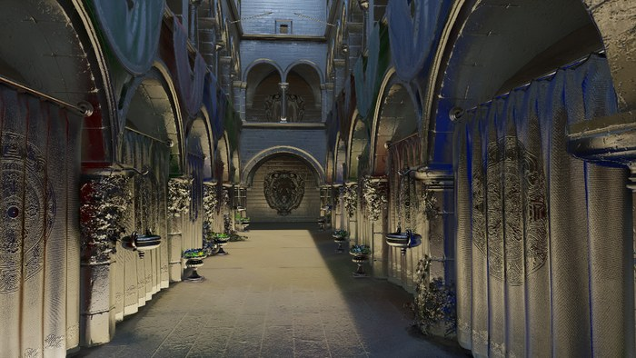

# Reflections

*Adapted from [Vuk Đorđević's master's thesis (ETF Belgrade, 2026)](https://github.com/MegatronJeremy/RG2/tree/master/master-rad/teza).*

`render.reflections.mode` selects the technique (default 1): 0 off, 1 screen-space ray march against the previous frame's colour (any GPU), 2 hardware ray query that re-shades the hit (needs ray-query support, falls back to off otherwise). Both write the same forward reflection slot, so the two can be compared on one scene. TAA is expected in either mode.



*Debug view `render.debugview` = 3: the reflection buffer before it is composited into the forward pass.*

## Pipeline (mode 2)

1. `Reflection.comp` runs at full resolution. It reads depth and perceptual roughness from the G-buffer, traces `render.reflections.rays` rays (default 1, clamped to 1-16) inside a cone of radius `roughness * render.reflections.cone_scale` around the mirror direction, and shades the closest hit through `ShadeSurfaceHit`. A ray that finds nothing within `render.reflections.range` (default 40 units) takes the sky cube.
2. `ReflectionTemporal` reprojects the previous buffer with the motion vectors and blends (`render.reflections.temporal.blend` 0.8 moving, `.maxblend` 0.95 static) with a depth-disocclusion reject.
3. The forward pass samples the buffer and lerps it over the prefiltered-environment specular.

The spatial a-trous filter exists but is off by default, for the reason measured below.

## Roughness cutoff

`render.reflections.max_roughness` (default 0.8) bounds both the trace and the composite. In the compute pass a pixel with `roughness >= max_roughness` exits before tracing. In the forward pass the weight is `saturate(1 - roughness / max_roughness)`, so reflected radiance fades to the cheap environment specular as roughness approaches the cutoff, and a pixel at the cutoff contributes zero, which is why skipping its ray is lossless. A perfect mirror (roughness 0) has a zero-width cone, so every sample of a multi-ray loop is the same deterministic ray.

No cost-versus-cutoff sweep is committed, so this page gives no millisecond figure for the cutoff; the cost below is for the default.

## Cost

Source: committed baselines `Scripts/perf-baseline/<adapter>/+refl.json`, commit `b253f91`, 2026-09-08. Sponza, 1920x1080, 300 frames per run, median of 5, default one ray per pixel.

| Pass | RX 9070 XT | RTX 5070 |
| --- | --- | --- |
| `Reflection` (trace) | 1.446 ms | 1.004 ms |
| `ReflectionTemporal` | 0.167 ms | 0.191 ms |
| Whole-frame step from `+ao` to `+refl` | +1.749 ms | +1.121 ms |

`ReflectionTemporal` on the 5070 spreads 14.7% across runs (0.176 to 0.324 ms), so its value is not resolved by this baseline. The `Reflection` pass spreads 0.2% on the 9070 XT and 3.9% on the 5070.

## Accuracy against the path tracer

Source: committed baselines `Scripts/quality-baseline/<adapter>/<viewpoint>__<technique>.json`, captured 2026-08-30 (9070 XT, commit `1fab18e`) and 2026-08-25 (5070, commit `188818e`). Each is a full real-time render of Sponza at one viewpoint against a converged path trace; FLIP lower is better, PSNR and SSIM higher.

| Viewpoint, adapter | Raster FLIP | SSR FLIP | RT FLIP | RT PSNR | RT SSIM |
| --- | --- | --- | --- | --- | --- |
| atrium, 9070 XT | 0.3631 | 0.3498 | 0.3401 | 17.20 | 0.504 |
| floor, 9070 XT | 0.4081 | 0.4056 | 0.4029 | 16.51 | 0.411 |
| gallery, 9070 XT | 0.5343 | 0.5343 | 0.5260 | 12.47 | 0.294 |
| atrium, 5070 | 0.3615 | 0.3485 | 0.3388 | 17.27 | 0.506 |
| floor, 5070 | 0.4077 | 0.4053 | 0.4025 | 16.53 | 0.412 |
| gallery, 5070 | 0.5344 | 0.5344 | 0.5261 | 12.51 | 0.294 |

RT ranks ahead of SSR and raster at every viewpoint on both cards, but by small margins: the largest gap to raster is 0.023 FLIP (atrium). Sponza has one low-contrast specular floor, so a reflection change moves few pixels (`AGENTS.md` measures 0.3% of pixels beyond 2/255). `Projects/Sandbox/assets/scenes/Reflections.world` (polished floor, mirror wall, roughness ladder) is the scene built to make the effect visible to a metric; it has no committed baselines yet.

## The denoiser is off: measured

The shared a-trous filter is guided by the receiver's normal and depth. Across a flat reflective surface both are constant, so the kernel is wide open exactly where reflected detail lives. `render.reflections.denoise.iterations` therefore defaults to 0.

Measured on `Sponza-Motion.world`, `all-rt`, iterations 0 against the old default 3 (numbers from `AGENTS.md` and the CVar description at `b767668`; neither the GPU nor the capture date is recorded there, so treat both as unstated):

| Metric | 0 iterations | 3 iterations |
| --- | --- | --- |
| FLIP (lower better) | 0.1742 | 0.1746 |
| PSNR | 21.7513 | 21.7047 |
| SSIM | 0.6473 | 0.6419 |
| JOD (higher better) | 4.7933 | 4.7728 |

Inside the filter's own footprint (the top 5% of pixels it changes) error rose from 23.327 at 0 iterations to 24.103 at 5. The pass costs 1.115 ms, 13.5% of the `+refl` frame at that rung, because it is full resolution with no upsample after it. SSIM improving alongside FLIP and PSNR is what separates this from metric gaming, since blur removal normally lowers SSIM. The default moved to off after an eyes-on check found the two indistinguishable. Two alternative guides, the luminance variance term and a hit-distance edge stop, moved JOD by 0.0013 and 0.0002, which is noise, and the hit-distance span stayed 0.0002 at 8 rays per pixel. A roughness-driven kernel (the NRD ReBLUR model) is the structurally right replacement and has to beat filter-off, not beat 3.

## Reproduce

```
py Scripts/perf-bench.py --only +refl
py Scripts/quality-bench.py --only rtrefl
py Scripts/quality-bench.py --only ssr
```
