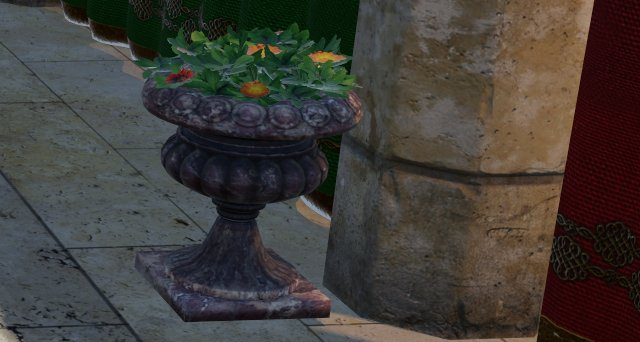
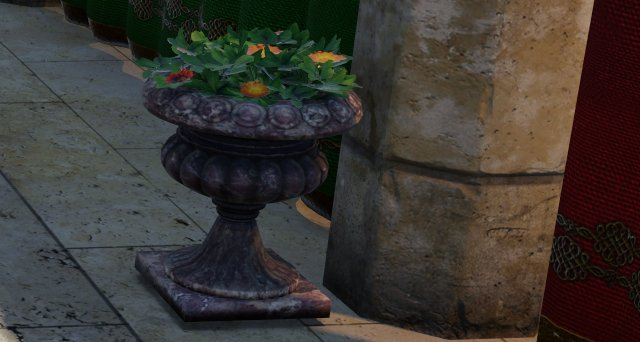
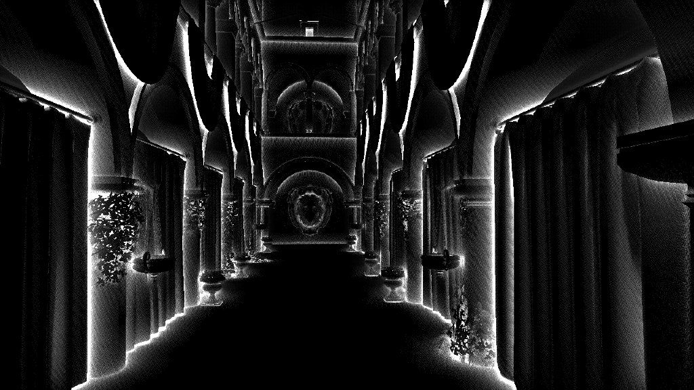
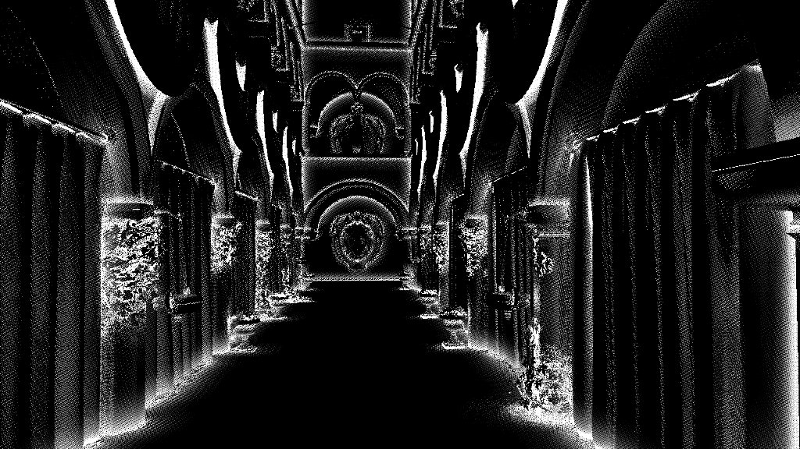

# RT ambient occlusion

*Adapted from [Vuk Đorđević's master's thesis (ETF Belgrade, 2026)](https://github.com/MegatronJeremy/RG2/tree/master/master-rad/teza).*

`render.ao.mode` selects the technique: 0 off (default), 1 SSAO (hemisphere kernel plus bilateral blur, any GPU), 2 ray traced (hardware ray query; falls back to off on a device without ray-query support). Both modes write the same forward AO slot, so the two A/B on one scene.

| AO off | AO on (mode 2) |
| --- | --- |
|  |  |

Thesis capture, a deliberate crop: occlusion happens where geometry encloses geometry, so over the whole frame the thesis measured the effect at 2.4 levels of 255 and 6.2 in this crop. What it buys is the plinth planted on the floor instead of floating over it, depth between the leaves, and the column meeting the ground.

## Technique

Per pixel, `render.ao.rays` (default 2) cosine-weighted hemisphere rays, rotated per pixel and frame by interleaved gradient noise, are traced inline against the scene TLAS with `RAY_FLAG_ACCEPT_FIRST_HIT_AND_END_SEARCH`, limited to `render.ao.radius` (default 0.5). A hit contributes `1 - saturate(t / radius)`, so nearer occluders darken more; `render.ao.intensity` scales the result. Cutout geometry is alpha-tested in the shader as for shadows.

The trace runs at `render.ao.scale` (default 0.5, a quarter of the pixels), then:

1. temporal accumulation (`render.ao.temporal`, history weight 0.9 moving to 0.97 when static);
2. a-trous denoise (`render.ao.denoise.iterations`, default 3, variance-guided);
3. depth-aware bilateral upsample to full resolution.

Hit-distance guidance in the a-trous (`render.ao.denoise.hitdist`) is off by default: the hit distance rides the raw 2-ray trace, which is too noisy between neighbours for the edge stop to separate anything.

## What the traced term sees that SSAO cannot

| SSAO | RT AO |
| --- | --- |
|  |  |

The isolated occlusion term, `1 - AO` at a gain of 4 on both sides, so bright is occluded. SSAO resolves a thin rim where surfaces meet in the depth buffer, which is all the depth buffer holds. The traced term gives drapes, vault soffits and foliage occlusion with body, because the occluder need not be on screen. Read it structurally: the raw stochastic buffer does not reproduce bit for bit, and two captures of one configuration differed by a mean of 3.8 of 255 against 8.8 between the techniques (thesis measurement).

## Quality against the path tracer

Source: committed baselines `Scripts/quality-baseline/<adapter>/{atrium,floor,gallery}__{raster,ssao,rtao}.json`, commit `1fab18e`, 2026-08-30. Mean over the three Sponza viewpoints; FLIP lower is better, PSNR and SSIM higher.

| Technique | GPU | FLIP | PSNR (dB) | SSIM |
| --- | --- | --- | --- | --- |
| raster (no AO) | RX 9070 XT | 0.4352 | 15.14 | 0.3823 |
| SSAO | RX 9070 XT | 0.4173 | 15.59 | 0.3982 |
| RT AO | RX 9070 XT | 0.4146 | 15.68 | 0.3996 |
| raster (no AO) | RTX 5070 | 0.4345 | 15.18 | 0.3835 |
| SSAO | RTX 5070 | 0.4177 | 15.61 | 0.3988 |
| RT AO | RTX 5070 | 0.4124 | 15.76 | 0.4019 |

Both techniques close most of the gap to the reference and sit within 0.003 FLIP (9070 XT) and 0.005 (5070) of each other. The static metric cannot separate them well on Sponza; the visible difference is in the term above. The remaining 0.41 FLIP is mostly the rest of the lighting (shadows, reflections, GI), since only AO is toggled here.

## Cost

Source: committed baselines `Scripts/perf-baseline/<adapter>/{shadows,+ao,ssao}.json`, commit `b253f91`, 2026-09-08. Sponza at 1920x1080, 300 frames per run, median of 5, `totalGpuMs`. Both AO rungs sit on top of RT shadows, so the delta is taken against the `shadows` rung.

| | RX 9070 XT | RTX 5070 |
| --- | --- | --- |
| `shadows` rung | 4.666 ms | 2.845 ms |
| + RT AO | 5.525 ms (+0.859) | 3.621 ms (+0.776) |
| + SSAO | 5.171 ms (+0.505) | 3.181 ms (+0.336) |
| RT AO own passes (AO, AOTemporal, AODenoise0-2, AOUpsample) | 0.582 ms | 0.578 ms |
| SSAO own passes (SSAO, SSAOBlur, AOUpsample) | 0.257 ms | 0.233 ms |

The own-pass rows are the per-pass `avgMs` sums from the same files; the remainder of each delta lands mostly in `Forward`, which reads the AO slot. RT AO costs about 1.7x SSAO on the 9070 XT and 2.3x on the 5070, for a FLIP gain of 0.003 to 0.005 over SSAO. On this scene the choice is made by the occlusion the term shows off-screen and behind thin occluders, not by the static number.

## Reproduce

```
py Scripts/perf-bench.py --only +ao
py Scripts/perf-bench.py --only ssao
py Scripts/quality-bench.py --only rtao
py Scripts/quality-bench.py --only ssao
```

The AO buffer alone is also available as a debug view (`docs/images/debug-ao.jpg`).
