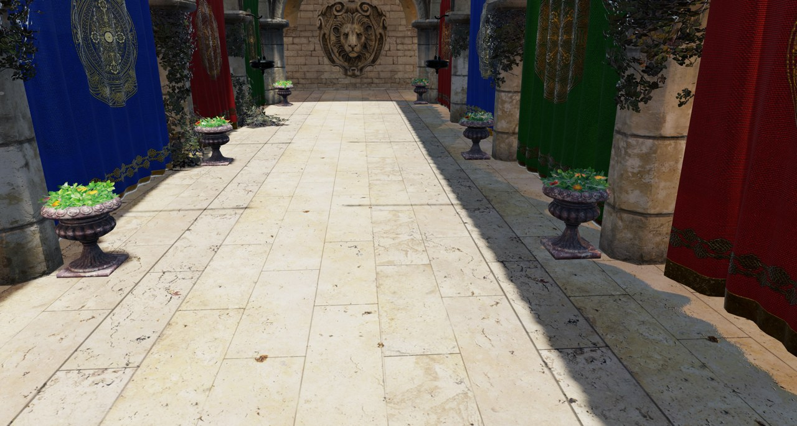
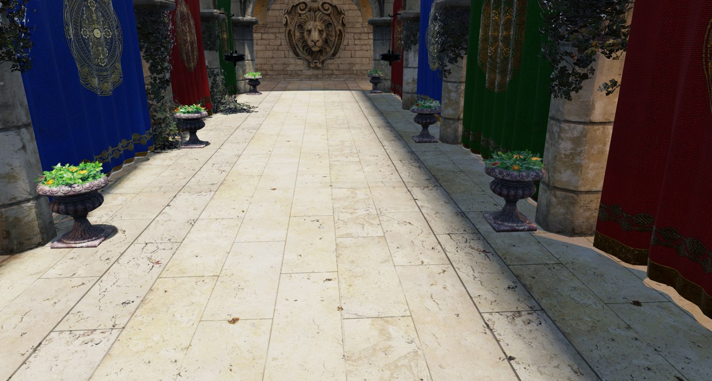
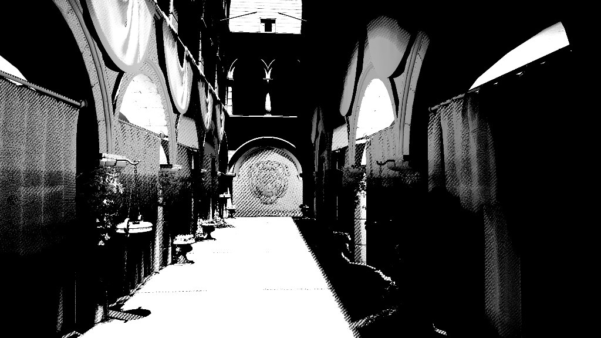

# RT shadows

*Adapted from [Vuk Đorđević's master's thesis (ETF Belgrade, 2026)](https://github.com/MegatronJeremy/RG2/tree/master/master-rad/teza).*

`render.shadows.mode` selects the shadow technique: 0 off, 1 raster shadow map with PCF (default), 2 ray traced. Mode 2 skips the raster shadow passes entirely and falls back to off on a device without ray-query support. Within mode 2, `render.shadows.stochastic` picks between two producers: per-light inline rays (default, the supported path) and an experimental stochastic aggregate pass.

| Shadow map (mode 1) | Ray traced (mode 2) |
| --- | --- |
|  |  |

Same pose and light. Look at the urns on the sunlit floor: the map has finite resolution and a depth bias, so contact shadows detach and smear, while the trace intersects the real geometry and needs no bias tuning.

## Inline path

Shadows are traced in `DefaultLit.frag.hlsl`, once per light per pixel at full resolution, with no denoiser. A shadow ray is a pure visibility test, so it uses `RAY_FLAG_ACCEPT_FIRST_HIT_AND_END_SEARCH`. Cutout geometry is resolved in the shader: non-opaque candidates come back through `q.Proceed()`, the material alpha is tested, and the hit is committed only if it passes. The ray origin is `positionWS + Ng * 0.02 + L * 0.01`.

Soft shadows (`render.shadow.soft`, on by default) cast `SHADOW_RAY_COUNT` = 2 rays per light, sampled uniformly by solid angle inside the cone the source subtends, and average them into a penumbra factor. The half-angle is half of `render.shadow.sun_angle_deg` (default 0.53, the sun's diameter) for the sun and `asin(r / d)` for a local light of radius `render.shadow.source_radius`. Directions come from spatiotemporal blue noise, so TAA can average the two-sample estimate over frames. Two rays quantize penumbra visibility to {0, 0.5, 1}, so a caster thinner than the penumbra band never reaches full umbra.

Cost grows linearly with light count.




*Debug views of the stochastic path's shadow ratio, raw and denoised (thesis captures, September 2026).*

## Stochastic path (experimental)

With `render.shadows.stochastic` on, each pixel importance-samples lights proportionally to their unshadowed contribution (`render.shadows.rays` rays per pixel, default 4, each picking a light independently), averages the visibility into one aggregate ratio, then reconstructs it with the shared SVGF chain: temporal accumulation, a-trous (`render.shadows.denoise.iterations`, default 3) and an upsample. Cost is nearly independent of light count. It is the same idea as the many-light technique in Unreal's MegaLights, at a prototype level. With `render.shadows.specular.demodulated` on (default) it adds a second denoised signal for specular.

It is not production-ready. It shows artifacts under camera motion where two lights overlap, consistent with per-pixel light selection differing between neighbouring pixels, and it relies on the a-trous filter to hide them (#170). The motion gate did not find this, because its route never renders the lit side aisles (#169). It measures more temporally stable than inline on that gate (tFLIP 0.0131 against 0.0154, per `AGENTS.md`), which says nothing about those artifacts.

## Cost: the ranking depends on the GPU

Source: committed baselines `Scripts/perf-baseline/<adapter>/{rt-off,shadows,shadows-stoch}.json`, commit `b253f91`, 2026-09-08. Sponza at 1920x1080, five lights enabled, 300 frames per run, median of 5, difference of `totalGpuMs` over `rt-off`.

| Producer | RX 9070 XT | RTX 5070 |
| --- | --- | --- |
| Inline, per light (default) | +2.292 ms | +1.526 ms |
| Stochastic, RIS + denoiser | +1.737 ms | +3.340 ms |

On the 9070 XT the stochastic path is cheaper; on the 5070 inline is cheaper by about 2.2x. The ordering inverts across vendors, so neither strategy is right for both. A plausible reason is that ray traversal driven from shader instructions competes with shading for the same execution resources, which makes rays relatively more expensive on one architecture; two whole-frame timings per card cannot separate that from clocks, caches or driver scheduling, so the mechanism is an expectation, not a finding.

Two limits on the claim:

- Five lights is one point on two curves. Inline grows with light count and stochastic does not, so they must cross somewhere on each card; this scene cannot show where.
- The 5070 rungs spread about 2-3% run to run and the stochastic chain includes the `ShadowSpec*` specular denoise rows that inline has no analogue for; turning `render.shadows.specular.demodulated` off removes part of that cost. `AGENTS.md` records those variant numbers.

`AGENTS.md` quotes slightly different deltas (9070 XT 2.272 and 1.723, 5070 1.294 and 3.362) from the same baseline directories; the table above is `totalGpuMs` differences recomputed from the JSON files at the commit named.

## Reproduce

```
py Scripts/perf-bench.py --only shadows
py Scripts/perf-bench.py --only shadows-stoch
```
