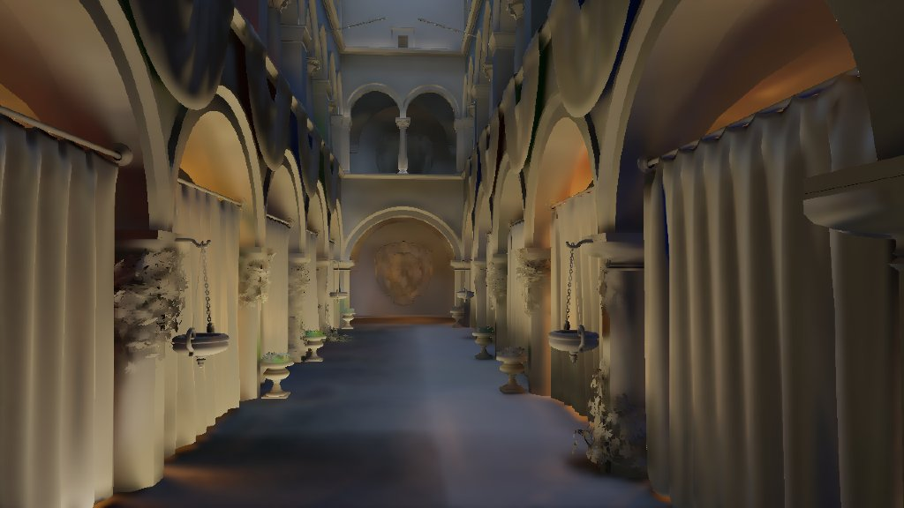
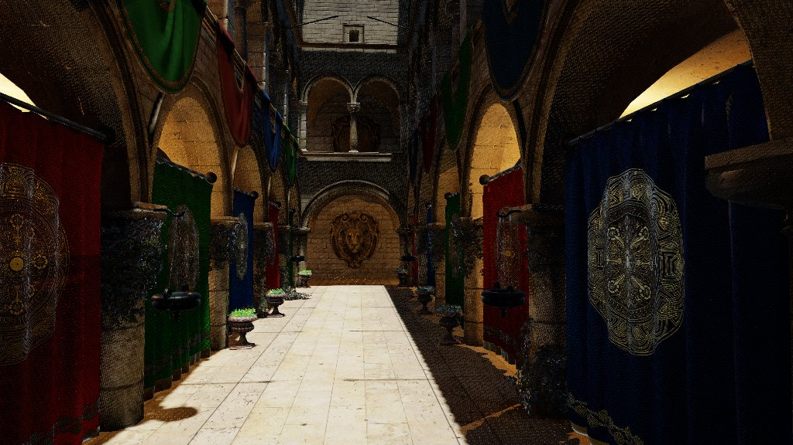

# SVGF-style denoising

*Adapted from [Vuk Đorđević's master's thesis (ETF Belgrade, 2026)](https://github.com/MegatronJeremy/RG2/tree/master/master-rad/teza).*

Every traced signal (GI, AO, reflections, the stochastic shadow pass) leaves the trace with one to four samples per pixel and goes through one shared reconstruction chain modelled on SVGF (Schied et al. 2017): temporal accumulation with variance tracking, then an edge-avoiding a-trous wavelet filter (Dammertz et al. 2010) whose luminance edge-stop is scaled by that variance. The chain exists so that two rays per pixel are enough. It is one shader pair, parameterised per effect through CVars.

| Left: raw half-res GI irradiance, as the trace leaves it | Right: the same buffer after temporal accumulation and a-trous |
| --- | --- |
|  |  |

`render.debugview` 6 and 7 show the two buffers at the Sponza atrium viewpoint, before the upsample and the composite. Source: thesis tooling on the RX 9070 XT; the high-frequency energy of the buffer falls from 41.7 to 1.5 (about 96%) between the two views, using the thesis's own high-frequency metric (defined in its ray-count section, not reproduced by an engine script). The engine commit of that capture was not recorded.

## Chain

| Stage | Shader | Role | Per-effect knobs (GI shown) |
| --- | --- | --- | --- |
| Temporal | `GITemporal.comp.hlsl` | Reproject history by the motion vectors, reject on depth disocclusion, blend, update luminance moments | `render.gi.temporal`, `.blend` 0.9, `.maxblend` 0.97 |
| A-trous | `GIDenoise.comp.hlsl` | 5x5 B3-spline filter, stride doubling per iteration (1, 2, 4), edge-stopped by normal, depth and variance-scaled luminance | `render.gi.denoise`, `.iterations` 3, `.variance` 4 |
| Upsample | `GIUpsample` | Depth-aware bilateral upsample from the half-res trace | `render.gi.scale` 0.5 |

AO, reflections and shadows run the same two shaders with their own CVars (`render.ao.*`, `render.reflections.*`, `render.shadows.*`). The `GIDenoise` file name is historical: it filters all of them.

**Temporal half.** Reprojection uses the full-res velocity buffer sampled at the half-res pixel. History is rejected off-screen and when the relative linear depth differs by more than `render.rt.depth_reject` (default 0.02, decoupled from the TAA threshold). The history weight lerps from `.blend` to `.maxblend` with how static the pixel is. Reprojected history is clipped to the current 3x3 range (`NeighborhoodClamp`) for GI, AO and reflections; the stochastic shadows turn that off because their per-frame estimate is bimodal and the clip would drag history dark at a multi-light overlap. The pass keeps the first and second luminance moments plus history length per pixel; a reset pixel (first frame, disocclusion) takes a 7x7 spatial variance instead, so the filter blurs young pixels hard until history builds.

**Spatial half.** Each tap weight is `B3(dx) * B3(dy) * wNormal * wDepth * wLuma`:

- `wNormal` is `saturate(dot(Nc, Nt))` raised to a power, so creases stop the filter;
- `wDepth` is `exp(-|dLinearDepth| / centerDepth * scale)`, a relative edge-stop, so one setting works near and far;
- `wLuma` is `exp(-|dLuma| / (phi * sqrt(variance) + eps))` with the variance pre-blurred by a 3x3 Gaussian, so noisy and just-disoccluded regions blur through the luminance edge while converged ones keep it. The variance is itself filtered with squared weights through the iterations and carried in the alpha channel.

The guide (normal, depth) is point-fetched from the full-res G-buffer, never bilinear, because a linear tap blends across silhouettes and fuzzes the edge-stop. AO adds a hit-distance term (`SS_DENOISE_HITDIST` permutation) and shadows a penumbra-scaled stride (`SS_DENOISE_PENUMBRA`); both are compiled out for GI. Sky pixels pass through untouched.

## What it buys

Source: thesis tooling `raycount_denoise_sweep.py`, results file `master-rad/teza/tools/raycount_denoise_results.json` in RG2 (RX 9070 XT, Sponza, 2 GI rays per pixel, TAA on, 90 settled frames, scored against the path tracer). The engine commit is not recorded in the file; the numbers describe the engine as it stood in the thesis, before 2026-09-16, and have not been re-run on current master. Temporal accumulation is on in both rows, so this isolates the spatial filter.

| GI a-trous | FLIP (lower better) | PSNR (dB) | SSIM | Frame-to-frame RMS delta, static camera |
| --- | --- | --- | --- | --- |
| off | 0.1446 | 24.67 | 0.7409 | 0.2185 |
| on (3 iterations) | 0.1449 | 24.65 | 0.7397 | 0.2038 |

The spatial filter changes the settled static frame by less than the run-to-run spread of these metrics: the temporal history is already doing the convergence, and the buffer downstream (upsampled, multiplied by albedo, added to dominant direct light, then TAA) hides the difference. Where it shows is flicker: a 6.7% lower RMS delta between frame N and N+1. That proxy is a static-camera measurement, not motion, and it is sensitive to protocol: without clearing temporal history before sampling, the unfiltered case is credited with noise accumulated while assets streamed, and the apparent reduction rises to about 40%. Figures from the two protocols are not comparable.

| Raw signal: denoiser, temporal and TAA off, 2 frames | Reconstructed: all three on, settled | Path-traced reference |
| --- | --- | --- |
|  |  |  |

Reading it honestly: at two rays per pixel with temporal accumulation active, the spatial a-trous is close to redundant for the final GI image, and the thesis concludes a reconstruction budget is better spent on the temporal side first. It stays on for GI (3 iterations) because it removes shimmer on disocclusion and costs little.

## Where the filter hurts: reflections

`render.reflections.denoise.iterations` defaults to 0. The filter is guided by the receiver's normal and depth, which is right for a diffuse gather and wrong for a view-dependent signal: on a flat mirror those guides are constant, so the kernel is wide open exactly where reflected detail lives. On `Sponza-Motion.world` with all RT effects on, turning the reflection a-trous off moved FLIP 0.1746 to 0.1742, PSNR 21.70 to 21.75 and SSIM 0.6419 to 0.6473 (all three improve, which separates it from simply deleting blur, where SSIM would drop) and saved 1.115 ms, 13.5% of the frame at the `+refl` rung. Figures are from `AGENTS.md`, which does not record the GPU or commit; the reflection page repeats them. A roughness-driven kernel (the NRD ReBLUR model) is the structurally right fix, and it has to beat filter-off, not beat 3 iterations. Hit-distance guidance and the variance term were tried and measured flat. See [Reflections](reflections.md).

## Cost

Source: committed baselines `Scripts/perf-baseline/<adapter>/+gi.json`, commit `b253f91`, 2026-09-08. Sponza at 1920x1080, 300 frames per run, median of 5, per-pass `avgMs` at the `+gi` rung (half-res chain, 3 iterations).

| Pass | RX 9070 XT | RTX 5070 |
| --- | --- | --- |
| GITemporal | 0.055 ms | 0.051 ms |
| GIDenoise0 (stride 1) | 0.134 ms | 0.091 ms |
| GIDenoise1 (stride 2) | 0.108 ms | 0.093 ms |
| GIDenoise2 (stride 4) | 0.090 ms | 0.129 ms |
| a-trous total | 0.333 ms | 0.313 ms |
| GIUpsample | 0.046 ms | 0.048 ms |

The chain is cheap because it runs at half resolution; the frame totals at that rung are 8.991 ms and 6.155 ms. Toggling the denoiser and diffing whole-frame totals gives about 0.07 ms, which is below the run-to-run spread of one configuration and should not be quoted as a cost. Read the per-pass rows.

The vendors disagree on the shape. The AMD chain is front-loaded (0.134 falling to 0.090 ms), the NVIDIA one inverts (0.091 rising to 0.129 ms). The shader's outer loop is deliberately rolled: unrolled it needed 191 VGPRs and ran at 8 of 16 waves; rolled it uses 72 VGPRs at 16 waves with no scratch. Measured on an RX 9060 XT (5 ABBA pairs, from the shader's comment), the full-res chains gained 36-47% and the half-res wide-stride iteration 25%, but the stride-1 iteration lost about 20%, net -12.9% frame time. Whether locality or occupancy drives the vendor asymmetry is not resolved by timestamps, which cannot separate them; memory counters would.

## Limits

- Temporal-only validation is thin: stability under camera motion is measured for whole techniques (`quality-motion.py`, tFLIP), not for this filter alone.
- Reflections and shadows should not simply inherit GI's setting: both are view-dependent or high-frequency signals the receiver-guided kernel over-blurs.
- Gains in the static frame are within noise; the case for the filter rests on disocclusion and flicker, which one static-camera proxy only partly covers.

## Reproduce

```
py Scripts/perf-bench.py --only +gi
py Scripts/quality-bench.py --only rtgi
py Scripts/quality-motion.py --only rtgi
```

Debug views: `--render.debugview=6` (raw) and `=7` (after temporal and a-trous). The thesis sweep script is in RG2 (`master-rad/teza/tools/raycount_denoise_sweep.py`).
