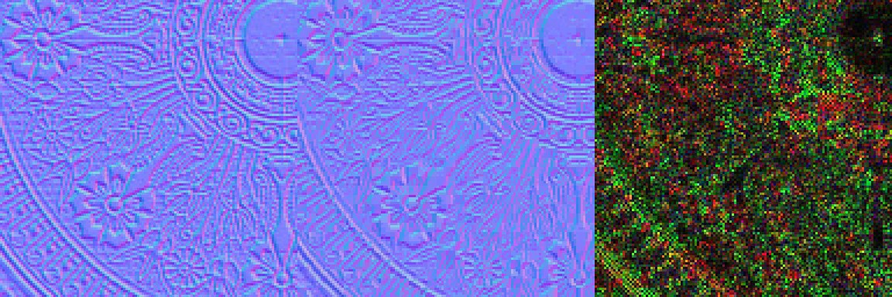
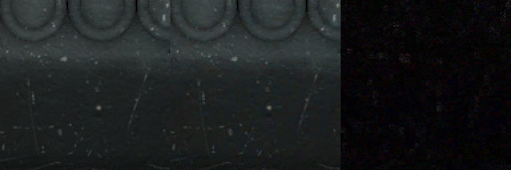

# Texture block compression

*Numbers are recorded in [`AGENTS.md`](../../AGENTS.md) (the authority where they differ) and in commit `32135a8` (2026-09-08). The cook-cache and virtual-path side is on the [Asset pipeline](asset-pipeline.md) page.*

`cook.textures.compress` (default on) block-compresses cooked textures. The encoding is chosen by **role**, not by one global format: the reference model is Unreal, Unity and Godot, which all default to BC1 for opaque albedo and BC5 for normals. Turn it off to cook exact RGBA8 when a texture must not be quantized.

## Role to format

The role comes from the material slot a texture is referenced through (`AssetManagerSingleton::RebuildTextureRoles`), rebuilt at registry load rather than stored per asset, so it needs no registry migration. Two materials disagreeing about one texture leave it Unknown and the conservative colour encoding wins.

| Role | Format | Why |
| --- | --- | --- |
| albedo, opaque | BC1, 4 bpp (BC7 at `cook.textures.quality=1`) | 8:1 against RGBA8 |
| albedo, alpha | BC3, 8 bpp (BC7 at `cook.textures.quality>=1`) | BC1's 1-bit alpha decodes to transparent black and bleeds halos; exhaustive BC7 took minutes per 2K texture |
| tangent normal | BC5, 8 bpp | two independent 8-bit planes; z reconstructed in the shader |
| metallic-roughness, AO | BC1, 4 bpp | measured adequate: 44.7 dB on roughness, 44.0 dB on metallic |

Mips are filtered in the role's colour space (`MipSpaceFor`): albedo in linear light, normals and masks as byte averages, alpha always linear. The cache blob header carries role, mip space, compress flag and an encoder revision, so a mismatch re-cooks. BC7 is an opt-in tier: it doubles opaque albedo to 8 bpp (51 MB to 102 MB on Sponza), and its FLIP delta is not measured.

## Why normals are not BC1

BC1 pushes a unit vector through one shared RGB565 line. Over the 22 conforming Sponza normal maps the mean angular error is **3.47 degrees with BC1 and 1.13 with BC5**. A texture in a normal slot is also checked by content (`IsTangentSpaceNormalMap`): two Sponza images there are not normal maps (vector length about 1.3, 25-40% of texels with z<0), and BC5 would raise their error, so they fall back to colour encoding with a warning.

BC5 stores no third channel, so every shader that samples a normal map decodes through `DecodeTangentNormal` (`Engine/Shaders/Include/NormalEncode.hlsli`), discriminating on a raw blue below 0.5. The path tracer uses the same helper, since it is the reference the quality gates compare against.

## Before and after

Source, BC1 round trip and 4x absolute error, 128 px crop at 3x:

| A Sponza tangent-space normal map | A Sponza colour texture |
| --- | --- |
|  |  |
| 28.25 dB over the full 1024x1024 texture | 42.45 dB over the full 1024x1024 texture |

Produced by `py Scripts/showcase-bc1-figure.py <texture> <out.jpg>` on 2026-10-17. This is an **offline numpy encoder** (PCA-axis fit), not the engine's libsquish cluster fit, and the PSNR is RGB against the source, not a render. It illustrates the mechanism and is not engine output or a GPU capture. There is no rendered before/after frame of compressed against uncompressed; the whole-frame cost is the FLIP figure below.

## Measured effect

Sponza's 72 textures, Radeon RX 9070 XT, Debug build, commit `32135a8`, 2026-09-08 (as recorded in `AGENTS.md`):

| Measure | Uncompressed | Compressed | Delta |
| --- | --- | --- | --- |
| Cooked cache | 390 MB | 69 MB | -82% (derived from the two sizes) |
| VMA allocation | 1373.3 MiB | 1074.8 MiB | -298.5 MiB, reproducible to the byte |
| Forward pass GPU time (per-run minimum) | 0.376 ms | 0.292 ms | -22% |

The Forward figure is an interleaved A/B on one binary with only the cache swapped: per-run ranges of 0.005 and 0.003 ms, no overlap, all four paired deltas the same sign. Block-compressed texels stay compressed in VRAM and are decoded in the texture unit, so the bandwidth saving is measured, not inferred.

**Cost.** Whole-frame FLIP against uncompressed is **0.026-0.028** across three viewpoints (0.045 before the role split and the encoder-quality fix). For scale, `all-rt` sits 0.103 from the path tracer, so this is not free. Default-on followed eyes-on confirmation on Sponza, since block artifacts on gradients are what whole-image numbers underweight.

The encoder asks libsquish for `kColourIterativeClusterFit` rather than `kColourRangeFit`: about +2 dB on every role at byte-identical output. Sampling a BCn image needs `textureCompressionBC` **enabled** in `VulkanContext`, not merely supported.

## Not measured

- No re-measurement was made for this page; every number is from `AGENTS.md` at the commit above, and the GPU numbers have not been re-run on the current master.
- BC7 (`cook.textures.quality=1`) FLIP delta.
- Release-build GPU time (the figures are Debug).

## Reproduce

```
py Scripts/Generate-Solution.py && cmake --build build --config Debug
Snowstorm-Editor --cook.assets
Snowstorm-Runtime --cook.textures.compress=0   # uncompressed arm; re-cooks on the key change
py Scripts/perf-bench.py --compare-exe <ref-exe> --pairs 3
```
